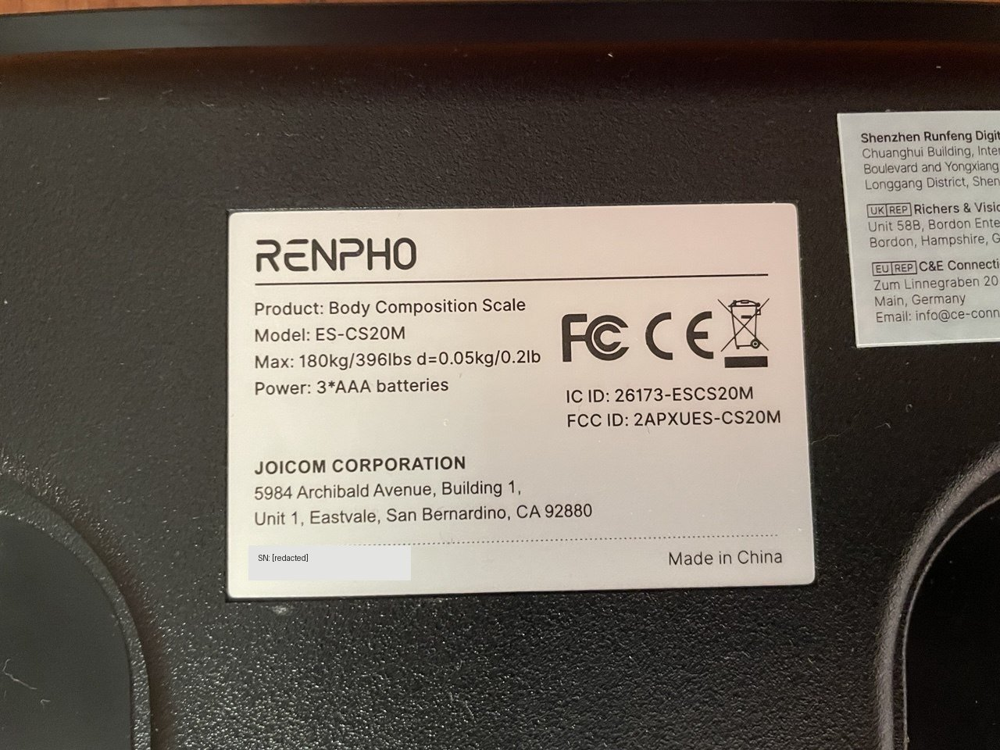

# BLE analysis of the Renpho ES-CS20M scale

An iPhone capture of a Bluetooth LE bathroom scale, decoded byte by byte, and two programs built on
the result: a web app that reads the scale from the browser, and a Raspberry Pi service that sends
every weighing to Telegram.

Try the web app at <https://robertodisanto.it/Analysis-BLE-ES-CS20M/>. Without a scale, it can
replay one of the [sample captures](samples/).

This is teaching material for the [CyberHackAdemy](https://cyberhackademy.unina.it/) at the
University of Naples Federico II. One small, real device is used to teach three topics:

1. Sniffing Bluetooth LE on iOS, and decoding a proprietary protocol from the captured bytes.
2. Continuous integration with GitHub Actions: tests on recorded data, a Docker build with a smoke
   test, automatic deployment.
3. Progressive web apps: an installable web app that works offline, uses Web Bluetooth and is
   published to GitHub Pages by CI.

## The device

A Renpho ES-CS20M body composition scale, hardware revision with FCC ID `2APXUES-CS20M`. Renpho
sells several ES-CS20M revisions that speak different protocols, and this one never accepts a
connection.



## What we found

The scale broadcasts every reading in clear in its Bluetooth advertisements. The vendor app answers
with advertisements of its own and hides its commands in a fake 128-bit service UUID. Anyone within
radio range can read the weight without pairing, and the scale cannot tell. The details are in
[docs/protocol.md](docs/protocol.md).

We did the analysis on our own, from the iPhone captures, and only afterwards looked for existing
projects. Three of them (openScale, renpho-escs20m and bluetooth_scale) already decode the same
`aa bb` frames. We did not find the app's replies documented anywhere else, nor the meaning of the
time, token and counter fields, the timing of a weighing, the iOS capture method or a browser
client. [docs/related-work.md](docs/related-work.md) has the comparison.

## The procedure

1. Capture the HCI traffic of an iPhone while weighing yourself with the vendor app open, using
   Apple's Bluetooth logging profile and PacketLogger on a Mac
   ([docs/sniffing-ble-on-ios.md](docs/sniffing-ble-on-ios.md)).
2. Find the scale among the advertisements of about thirty nearby devices. It uses company ID
   `0xFFFF` (reserved for testing), carries its own MAC address in the payload, and the app
   advertises a UUID that ends with that same address.
3. Look for the weight shown by the app inside the bytes and explain the other fields. A second
   capture confirmed the decoding and revealed the byte that marks the final weight.
4. Anonymise the captures before sharing them
   ([`tools/anonymize_capture.py`](tools/anonymize_capture.py)).
5. Compare with prior work, starting from the model and FCC ID on the label
   ([docs/related-work.md](docs/related-work.md)). We did this last; it is better done first.
6. Build a decoder, a web app and a Raspberry Pi service, all tested against the recorded samples
   in CI.

## Repository

| Path | Content |
|---|---|
| [`docs/`](docs/) | The capture procedure, the protocol analysis, related work and the label photo |
| [`samples/`](samples/) | Anonymised PacketLogger captures: a complete and an interrupted weighing |
| [`tools/`](tools/) | `decode_capture.py` (decoder) and `anonymize_capture.py`, Python standard library only |
| [`webapp/`](webapp/) | The progressive web app |
| [`raspberry/`](raspberry/) | `scale-bot`, the Raspberry Pi to Telegram service, with Docker Compose |
| [`test/`](test/) | Tests of the web app's decoder |
| [`.github/workflows/`](.github/workflows/) | CI: tests, Docker build, GitHub Pages deployment |

```sh
python3 tools/decode_capture.py samples/complete-weighing.pklg
```

## The web app

[`webapp/`](webapp/) is a static progressive web app with no build step and no dependencies. It is
published at <https://robertodisanto.it/Analysis-BLE-ES-CS20M/>.

- It listens to the scale's advertisements with Web Bluetooth (`watchAdvertisements()`, or
  `requestLEScan()` where available), since there is nothing to connect to.
- It shows the live reading and saves final weights in the browser.
- It can replay a `.pklg` capture, so it can be tried with the samples and no scale.
- It can export every frame it received as CSV, to see what the browser really got during a
  weigh-in.
- It warns when the weight goes back to zero without a final frame.
- It installs as an app and works offline thanks to a service worker.
- The interface is in English and Italian, following the browser's language until you pick one,
  and the theme can be light, dark or automatic (following the system).

It needs Chrome or Edge on a desktop, with Bluetooth on and the
`chrome://flags/#enable-experimental-web-platform-features` flag enabled: Chrome still keeps
advertisement scanning behind that flag. There are reports of advertisement events never arriving
on Linux and macOS, so Windows is the most promising platform.

A browser can only listen, so it cannot send the time and acknowledgement that the phone app sends.
The scale confirms the weight anyway. In our tests Chrome delivered far fewer advertisements than
the scale sends: about one per second while the weight moved, and the repeated final frame only
once.

The [`webapp.yml`](.github/workflows/webapp.yml) workflow tests the decoder on the samples and, on
every push to `master`, publishes `webapp/` to GitHub Pages. To enable it on a fork, set
*Settings → Pages → Source* to *GitHub Actions*. Web Bluetooth needs https, which Pages provides.

## The Raspberry Pi service

[`raspberry/`](raspberry/) holds `scale-bot`, a Python service that listens to the scale around the
clock from a Raspberry Pi, stores every final weight in SQLite and sends it to a Telegram chat. It
runs with Docker Compose or as a systemd service; see its [README](raspberry/README.md).

## Continuous integration

| Workflow | What it does |
|---|---|
| [`webapp.yml`](.github/workflows/webapp.yml) | Node tests of the decoder on the samples, then deployment to GitHub Pages |
| [`raspberry.yml`](.github/workflows/raspberry.yml) | Python tests on 3.11 and 3.13 with a fake Telegram server, Docker image build, replay of a sample inside the container |

The recorded captures work as test fixtures: every component is checked against the same real
traffic, without a scale or a Bluetooth adapter on the CI runner.

## Ethics and scope

Only analyse devices you own. The samples are anonymised: the scale's MAC address, the session token
and the weights were rewritten, and the serial number is masked in the label photo. This project is
not affiliated with or endorsed by Renpho. "Renpho" and "ES-CS20M" are trademarks of their owners
and appear here only to identify the device. `QN-S500` is the name the vendor app advertises.

## License

[MIT](LICENSE)
